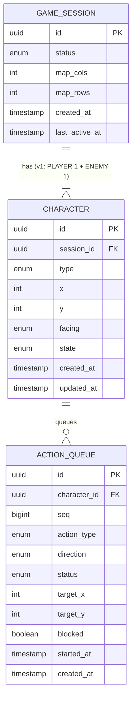

# Say2Play ERD v1 (싱글플레이)

## 1. 개요

- 기준 프로토타입: `gameclient/` (13×9 그리드 탑뷰 훈련장, 플레이어 + 적 캐릭터)
- 사용자 계정은 없고 **게스트 세션**으로만 식별한다.
- 모든 게임 상태는 **서버 메모리**에 둔다. 클라이언트는 서버가 보내는 상태를 렌더링만 한다.
- 영구 저장(DB)은 하지 않는다. 아래 테이블은 서버가 메모리에 들고 있는 엔티티 구조이며, 세션이 끝나면 모두 폐기된다.
- Action Set은 코드에 고정한다(→ 4. 코드 고정값). AI는 입력 텍스트 1건을 항상 Action Set 안에서 가장 비슷한 Action **1개**로 매칭한다.
- 세션 하나에 캐릭터가 2개(`PLAYER`, `ENEMY`) 있고, **한 사용자가 두 캐릭터를 각각 텍스트로 조종**한다. 캐릭터마다 큐가 따로 있어 독립적으로 실행된다.
- 이후 멀티플레이(같은 세션 상태를 여러 클라이언트에 브로드캐스트)를 고려해 `GAME_SESSION`과 `CHARACTER`를 1:N으로 분리한다.

### 처리 흐름

1. 클라이언트가 세션을 생성하면 서버가 `GAME_SESSION`과 `CHARACTER` 2개(`PLAYER`, `ENEMY`)를 만든다.
2. 사용자가 조종할 캐릭터를 정해 입력한 원문 텍스트를 서버로 보낸다.
3. 서버가 텍스트를 AI에 넘기고, AI는 Action Set 중 가장 비슷한 Action 1개(종류, 방향)를 반환한다.
4. 서버는 반환된 Action을 해당 캐릭터의 `ACTION_QUEUE`에 넣고 순서대로 실행하며 `CHARACTER` 상태를 갱신한다.
5. 서버가 갱신된 상태를 클라이언트에 전송한다. 멀티플레이에서는 같은 세션의 모든 클라이언트에 브로드캐스트한다.

---

## 2. ERD

---

## 3. 테이블 명세

> 메모리 엔티티이므로 타입은 논리 타입이다.

### GAME_SESSION: 게임 세션 (방)

| 컬럼 | 타입 | 제약 | 설명 |
| --- | --- | --- | --- |
| id | uuid | PK | 세션 식별자. 클라이언트가 이후 요청과 연결에 사용 |
| status | enum | NOT NULL, DEFAULT 'PLAYING' | 세션 상태 (`PLAYING`, `ENDED`) |
| map_cols | int | NOT NULL, DEFAULT 13 | 맵 가로 칸 수 |
| map_rows | int | NOT NULL, DEFAULT 9 | 맵 세로 칸 수 |
| created_at | timestamp | NOT NULL | 세션 생성 시점 |
| last_active_at | timestamp | NOT NULL | 마지막 입력 시점. 유휴 세션 정리 기준 |

---

### CHARACTER: 세션 내 캐릭터 상태

| 컬럼 | 타입 | 제약 | 설명 |
| --- | --- | --- | --- |
| id | uuid | PK | 캐릭터 식별자 |
| session_id | uuid | FK(GAME_SESSION), NOT NULL | 소속 세션 |
| type | enum | NOT NULL, UK(session_id, type) | 캐릭터 종류 (`PLAYER`, `ENEMY`). 세션당 종류별 1개 |
| x | int | NOT NULL | 확정된 그리드 열 좌표 (0 ~ map_cols-1). 이동 동작이 끝날 때 갱신 |
| y | int | NOT NULL | 확정된 그리드 행 좌표 (0 ~ map_rows-1). 이동 동작이 끝날 때 갱신 |
| facing | enum | NOT NULL | 바라보는 방향 (`N`, `E`, `S`, `W`) |
| state | enum | NOT NULL, DEFAULT 'IDLE' | 현재 동작 (`IDLE`, `MOVING`, `TURNING`, `ATTACKING`, `DEFENDING`, `ROLLING`) |
| created_at | timestamp | NOT NULL | 생성 시점 |
| updated_at | timestamp | NOT NULL | 최근 상태 변경 시점 |

- 시작 상태 (→ 4. CHARACTER_START)

---

### ACTION_QUEUE: 실행 대기/진행 중인 동작

| 컬럼 | 타입 | 제약 | 설명 |
| --- | --- | --- | --- |
| id | uuid | PK | 동작 식별자 |
| character_id | uuid | FK(CHARACTER), NOT NULL | 동작을 수행할 캐릭터 |
| seq | bigint | NOT NULL | 실행 순서. 캐릭터별로 증가 |
| action_type | enum | NOT NULL | Action 종류 (→ 4. ACTION_TYPE) |
| direction | enum |  | `MOVE`: `N`/`E`/`S`/`W`, `TURN`: `LEFT`/`RIGHT`, 그 외는 null |
| status | enum | NOT NULL, DEFAULT 'QUEUED' | `QUEUED`, `RUNNING`. 완료되면 큐에서 제거 |
| target_x | int |  | `MOVE`/`ROLL`의 목표 칸 x. 실행 시작 시 계산, 그 외는 null |
| target_y | int |  | `MOVE`/`ROLL`의 목표 칸 y. 실행 시작 시 계산, 그 외는 null |
| blocked | boolean | NOT NULL, DEFAULT false | 충돌로 이동하지 못했는지 여부. 막히면 목표 칸은 현재 칸과 같음 |
| started_at | timestamp |  | 실행 시작 시점. `started_at + duration`이 지나면 완료 |
| created_at | timestamp | NOT NULL | 큐 등록 시점 |

- 입력 1건은 항상 행 1개(동작 1번)가 된다. 반복이나 여러 동작으로 나누는 처리는 없다.
- 큐는 이전 동작이 끝나기 전에 다음 입력이 들어올 때만 쌓인다.
- 실행 중인 동작을 포함해 캐릭터당 최대 100개까지 넣을 수 있다.
- 입력 원문은 서버가 보관하지 않는다. 화면에 표시할 문구는 클라이언트가 자신이 보낸 텍스트로 직접 관리한다.

---

## 4. 코드 고정값

### ACTION_TYPE: Action Set

| 값 | direction | duration(s) | 효과 |
| --- | --- | --- | --- |
| MOVE | `N` / `E` / `S` / `W` | 0.32 | 지정 방향으로 1칸 이동. facing은 유지 |
| TURN | `LEFT` / `RIGHT` | 0.30 | facing을 90도 회전 |
| ATTACK | - | 0.48 | facing 방향으로 공격 (v1은 피해 판정 없음) |
| DEFEND | - | 1.10 | facing 방향으로 방어 (v1은 피해 판정 없음) |
| ROLL | - | 0.50 | facing 방향으로 1칸 이동 |

- 입력 1건은 Action 1개로만 매칭되고 1회 실행된다. 반복(예: "위로 3칸")이나 연결(예: "위로 가서 공격")도 가장 비슷한 Action 1개로 처리된다.

### 이동 규칙 (MOVE, ROLL)

- 목표 칸이 맵 경계를 넘으면 경계 칸에서 멈춘다.
- 목표 칸이 아래 중 하나면 이동하지 않고 제자리에 머문다(`blocked = true`).
  - 다른 캐릭터의 현재 칸(`x`, `y`)
  - 다른 캐릭터가 이동 중인 목표 칸(`RUNNING` 동작의 `target_x`, `target_y`)
- 막히더라도 동작 시간은 그대로 소요된다.

### CHARACTER_START: 캐릭터 시작 상태

| type | x | y | facing |
| --- | --- | --- | --- |
| PLAYER | 6 | 7 | `N` |
| ENEMY | 6 | 1 | `S` |

- 좌표는 좌상단이 `(0, 0)`이고, 오른쪽이 `x+`, 아래쪽이 `y+`다.
